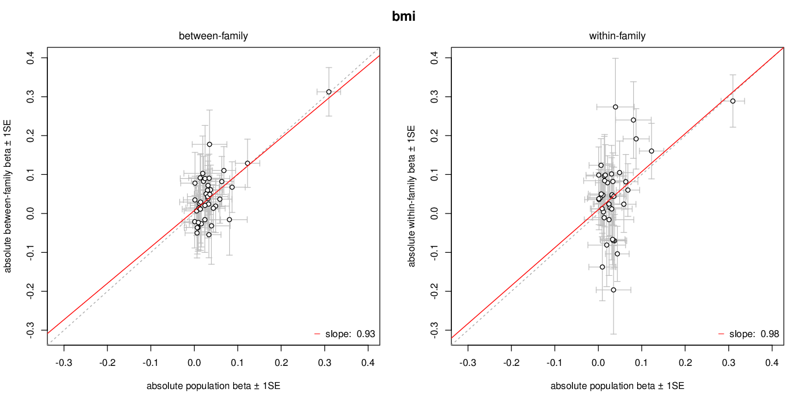

# siblingGWAS

Use information from genotyped dizygotic siblings to assess the robustness of GWAS analyses, by estimating within-family (WF) and between-family (BF) effects of genetic variants on continuous traits. This work is derived from [LaurenceHowe/SiblingGWAS](https://github.com/LaurenceHowe/SiblingGWAS).

For each variant, `siblinggwas` fits:

* **Model 1** (all individuals): `PHENOTYPE ~ GENOTYPE + covariates`. This gives the population effect (`BETA_TOTAL`).
* **Model 2** (siblings only): `PHENOTYPE ~ FAM_MEAN + CENTRED_GENOTYPE + covariates`. This gives the between-family (`BETA_BF`) and within-family (`BETA_WF`) effects.

Standard errors are clustered on family.

From v0.3.0, siblingGWAS is a Rust program. It takes the same inputs and writes the same results table as the R scripts in earlier versions, agrees with them to within about 1e-11, and is much faster. The original R scripts are kept in [`validation/`](validation/), which also has the code that checks the two implementations against each other (see [Agreement with the R scripts](#agreement-with-the-r-scripts)).

## Installation

With Cargo:

```
cargo install --git https://github.com/MRCIEU/siblingGWAS
```

Or clone this repository and build it:

```
cargo build --release
./target/release/siblinggwas --help
```

Or build the Docker image, which contains only the `siblinggwas` binary:

```
docker build -t mrcieu/siblinggwas .
docker run --rm -v "$PWD:/data" -w /data mrcieu/siblinggwas siblinggwas --raw ... --out ...
```

## Usage

```
siblinggwas --raw <raw file> --bim <bim file> --phenotypes <phenotype file> \
    --covariates <covariate file> --siblings <sibling file> --out <output prefix> \
    [--no-se] [--plot] [--threads N]
```

| Option | Description |
| --- | --- |
| `--raw` | Genotypes for all samples, from `plink2 --recode A` ("Sample-major additive (0/1/2) coding, suitable for loading from R...") |
| `--bim` | The matching [plink extended variant information file](https://plink.readthedocs.io/en/latest/plink_fmt/#bim) |
| `--phenotypes` | A delimiter-separated file with exactly three columns, `FID` `IID` `<phenotype>`, and one row per sample in the whole dataset. The phenotype column can be given any sensible name. |
| `--covariates` | A delimiter-separated file with `FID` `IID` followed by one or more covariate columns, and one row per sample in the whole dataset |
| `--siblings` | A delimiter-separated file with exactly two columns, `IID` `FID_FS`, where `FID_FS` identifies dizygotic sibling families (see [the original method](https://github.com/LaurenceHowe/SiblingGWAS)). One row per sibling. |
| `--out` | Output prefix |
| `--no-se` | Don't calculate standard errors and p-values. The output table has fewer columns. |
| `--plot` | Also write `<prefix>_pop_vs_family_beta.pdf` |
| `--threads` | Number of threads (default: all cores) |

We use LD-clumped, significantly associated variants as input. Progress and warnings go to stderr.

### Output

`<prefix>_within-family-table.tsv` has one row per variant. It contains the variant's `CHR`, `SNP`, `BP`, `A1` and `A2`, the number of individuals in model 1 (`N_REG`), and the estimates (`BETA_*`). Without `--no-se` it also contains their standard errors (`SE_*`), p-values (`P_*`) and the elements of each model's clustered variance–covariance matrix (`VCV_*`).

With `--plot`, `<prefix>_pop_vs_family_beta.pdf` plots each variant's absolute population effect against its between-family effect (left) and its within-family effect (right). Each point has ±1 SE bars, and each panel shows the y = x line, a regression line and its slope. Effects are flipped so that the population effect is positive. The title is the last component of the output prefix.

<p align="left">
  
</p>

## Agreement with the R scripts

[`validation/`](validation/) contains:

* the original R implementation, `within-family.R` and `within-family-plots.R`. It needs the R packages data.table, lmtest, optparse, sandwich and R.utils.
* `simulate.R`, which simulates inputs, including missing data, factor covariates and edge-case variants;
* `run_comparison.sh`, which runs both implementations and compares every output cell (`compare.R`);
* `compare_plots.sh`, which draws both plots from the same table. The results are in [`validation/plots/`](validation/plots/).

```
Rscript validation/simulate.R /tmp/wf 3000 800 40 10 standard
validation/run_comparison.sh /tmp/wf validation/within-family.R
validation/run_comparison.sh /tmp/wf validation/within-family.R --no-se

Rscript validation/simulate.R /tmp/wf-clean 3000 800 40 10 clean
validation/compare_plots.sh /tmp/wf-clean validation/within-family-plots.R validation/plots
```

All values agree to within about 1e-11 relative, and every NA is in the same place. R's behaviour in degenerate cases is reproduced: collinear covariates, aliased genotype terms, models with no observations, and factors with fewer than two levels.

### Differences from the R scripts

These are deliberate, or only matter for unusual inputs:

* **Duplicate IDs are an error.** R's `merge` would silently duplicate those individuals.
* **The number of variant columns in the `.raw` file must equal the number of `.bim` rows.**
* **Covariate names are used as given.** R upper-cases them, and fails if one is named `SEX` or isn't valid in a formula.
* **Factor levels are sorted in byte (C-locale) order**, not in the session locale. Only the intercept (`*_0`) columns depend on the reference level.
* **Empty fields in character covariates are missing**, not an empty-string level.
* **The delimiter is detected from the header line**: tab if present, otherwise comma, otherwise whitespace.
* **Zero covariates are supported.**
* **Variants with missing effects are left out of the plot**, where `within-family-plots.R` would stop with an error.

## Licence

GPL-3.0-or-later; see [LICENSE](LICENSE). Third-party notices are in [NOTICE](NOTICE). `siblinggwas -l` prints a summary and `siblinggwas --licences` the full text.

The original R scripts, `validation/within-family.R` and `validation/within-family-plots.R`, are MIT-licensed; see [validation/LICENSE-MIT](validation/LICENSE-MIT).
